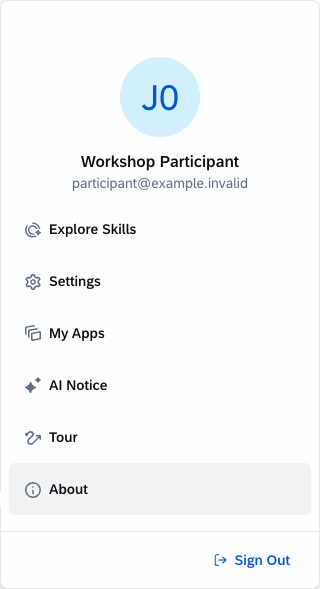
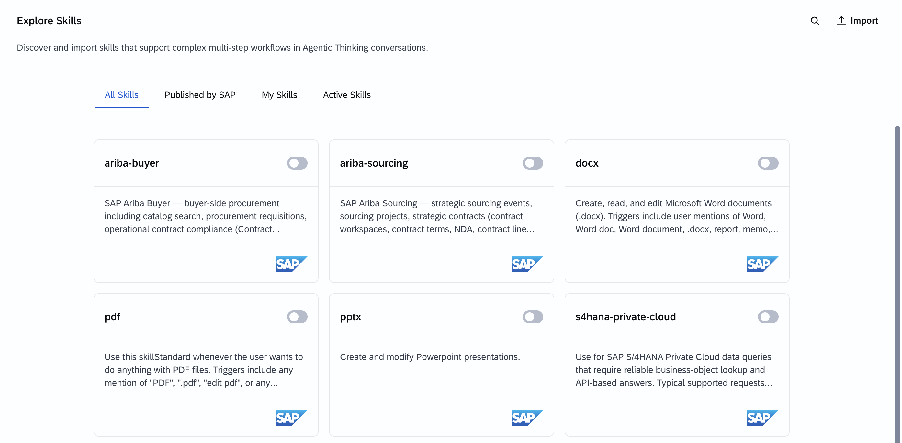
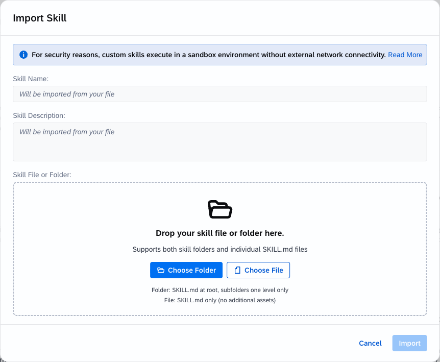

# Exercise 0: Log In, Set Up, and Get Ready

## Goal

Sign in, prepare the workshop files, and confirm that you can import and test a custom skill. Complete this readiness exercise before Exercises 1-4; the optional exploration below is not required.

## Step 1: Sign In

1. Open the workshop tenant URL supplied by your facilitator.
2. Sign in with your assigned workshop identity and complete authentication if prompted.
3. Confirm that Joule Work opens.

If sign-in fails, contact the facilitator. Do not use another participant's identity.

## Step 2: Check Joule Work Access

1. Start a new conversation. In the message input, select **+ > Agentic Thinking**.

   

2. Open **User menu > Explore Skills**.

   

3. Confirm that you can open **My Skills** and see **Import**.

   

If **Import** is missing, ask the facilitator about preimported examples or pairing with an authorized participant. You may inspect and test a preimported skill, but you still need an authorized import path to test your own edits. If **Agentic Thinking** is missing, stop and ask the facilitator.

## Step 3: Prepare the Files

1. Download or clone this repository. If downloaded as a ZIP, extract it.
2. Locate `exercises/ex0/` through `exercises/ex5/`.
3. In `exercises/ex1/`, confirm that `broad-greeter/` and `workshop-greeter/` each contain `SKILL.md`.

## Step 4: Understand Import Formats

The workshop tenant's import dialog supports an individual `SKILL.md` or an unzipped skill folder. **Do not create a skill ZIP for import.** A repository ZIP or a source package attached to a conversation is different from catalog import.



- **Simple skill:** choose `SKILL.md` directly.
- **Supporting files:** choose the complete folder, with `SKILL.md` at its root and supporting files one subfolder level below it.

```text
gross-margin-calculator/
├── SKILL.md
├── references/
│   └── formulas.md
└── scripts/
    └── calculate_margin.py
```

Custom skill scripts run without external network access. They process supplied data; SAP-published capabilities handle authorized business-system retrieval.

## Step 5: First Interaction

Once the readiness check is complete, open a new conversation, enable agentic thinking mode, and send these prompts one at a time to get a feel for how Joule communicates.

1. `Who are you and what can you help me with?`

   Joule introduces itself and summarizes its capabilities.

2. `What are your limitations? What can't you do?`

   Knowing what Joule won't do is just as useful as knowing what it will.

3. `Can you do a quick calculation? If we raised 47 purchase orders at an average value of $12,400 each, what is the total spend?`

   Expected answer: **$582,800**. A quick way to confirm the conversation is live and responding correctly.

## Optional: Explore SAP-published Skills

The workshop exercises focus on custom skills you build yourself. Before you start, you can also explore what Joule's pre-shipped SAP skills can do on their own. These skills connect to live S/4HANA and SuccessFactors data in the workshop tenant.

### Enable the LOB skills

1. Open **User menu > Explore Skills**.
2. On the **Published by SAP** tab, find the SAP-published skills. They appear alongside any custom skills you have imported. SAP-published skills are marked with SAP as the publisher.
3. Enable `SAP S/4HANA Cloud Public Edition` and `SAP SuccessFactors HCM` using the toggle on each card.
4. Confirm that both appear under **Active Skills**.
5. Open a new conversation and enable agentic thinking mode.

### S/4HANA — purchasing and finance data

Try these prompts one at a time:

- `Show me my last 5 purchase orders.`
- `Drill into the first PO from the list above and show me its line items.`
- `Show me all open vendor invoices from last month.`

Joule pulls data from S/4HANA without you naming a transaction code or Fiori app.

### SuccessFactors — HR and org data

Try these prompts one at a time:

- `What is my current job title and cost centre?`
- `Who is my manager and who reports to me?`
- `How many employees do we have in the Manufacturing division?`

Joule identifies your user account automatically and returns live data from SuccessFactors.

---

## Readiness Check

Confirm that:

- you are signed in with your assigned workshop identity;
- **Agentic Thinking** and **Explore Skills** are available;
- you can import skills, or the facilitator has arranged an authorized alternative;
- the repository is extracted and you can locate the exercise files;
- you know when to import a file versus a complete folder.

Continue to - [Exercise 1: Compare Skill Behavior](../ex1/README.md)
