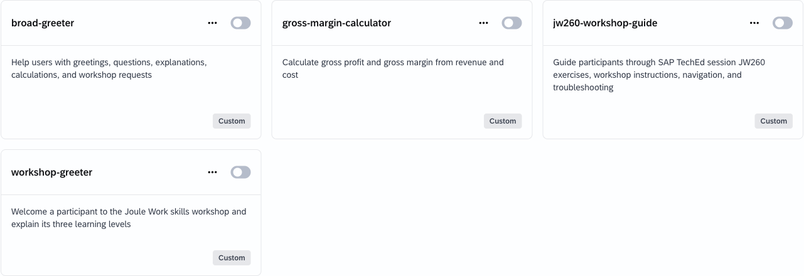
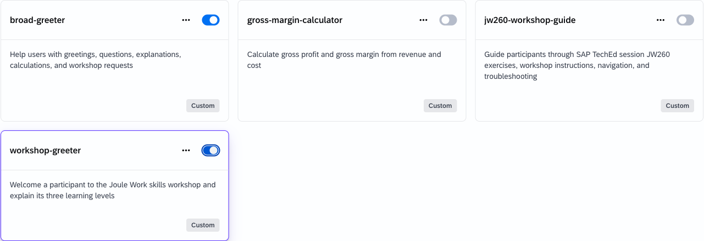
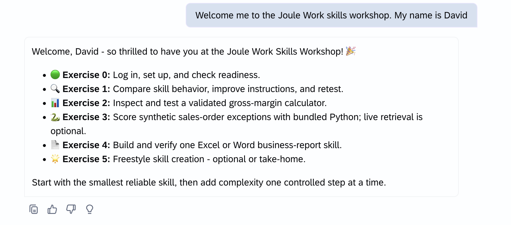

# Exercise 1: Compare Skill Behavior

## Goal

Observe how skill descriptions and instructions affect routing and response reliability, then improve a flawed skill using evidence from Joule Work.

> [!warning] Teaching anti-pattern
> `broad-greeter` is an intentionally poor example created for this exercise. Do not copy it into production skills.

<!-- TEACHING ANTI-PATTERN: broad-greeter intentionally creates routing overlap. -->
<!-- TEACHING ANTI-PATTERN: broad-greeter intentionally leaves output behavior underspecified and inconsistent. -->

## Timebox: 18 minutes

- Observe: 6 minutes
- Diagnose: 4 minutes
- Improve: 4 minutes
- Retest: 4 minutes

## Before You Start

Import each top-level skill folder unzipped:

- `broad-greeter`
- `workshop-greeter`

Each folder must contain its named `SKILL.md`. In Joule Work, use **Explore Skills > Import** to import both folders. Before testing, disable `jw260-workshop-guide` and any other custom workshop skills so they do not compete with the two skills used in this exercise. Enable only `broad-greeter` and `workshop-greeter` on **My Skills**, then start a new conversation and select agentic thinking mode.

> [!important]
> Keep `jw260-workshop-guide` disabled throughout Exercise 1. Re-enable it after completing the exercise when you need workshop navigation or troubleshooting help.

After import, both custom skills appear on **My Skills**:

Enable both skills before the first comparison run. A blue toggle indicates an enabled skill.

## Observe - 6 Minutes

Run each exact prompt twice with both skills enabled:

1. `Welcome me to the Joule Work skills workshop. My name is NAME.`
2. `Hello, I am NAME. Tell me what I will learn in the Joule Work skills workshop.`
3. `Help me get started with the Joule Work skills workshop.`

After every run, note the routed skill if Joule shows it and compare the visible response qualities: correct use of the name, three learning levels, the exact closing sentence, and concise, consistent wording. If your tenant does not expose the selected skill, record `Not visible` and base the comparison on the response only.

The required closing sentence for comparison is: `Start with the smallest reliable skill, then add complexity one controlled step at a time.`

The recommended skill produces the three learning levels and exact closing sentence. Your routed skill may differ while both skills are enabled, which is why repeated runs matter.

> [!NOTE]
> **Selection is not deterministic**
> Skill selection can vary between runs, tenants, and surrounding conversation. A flawed skill is not guaranteed to fail on every prompt. Your evidence is the behavior observed across repeated prompts, not a promised routing result or guaranteed failure.

## Diagnose - 4 Minutes

Open both `SKILL.md` files and compare them with your observations.

- Identify description words that overlap with unrelated requests or with another skill.
- Identify instructions that leave the number, content, order, length, or closing of the response undefined.
- For each observed difference, cite one metadata or instruction line that could explain it.
- Decide whether your strongest evidence concerns routing, output reliability, or both.

## Improve - 4 Minutes

Improve `broad-greeter`.

Narrow its `description` and instructions to one distinct greeting use case that does not overlap with `workshop-greeter`. Add one explicit negative boundary. Define a reliable output contract covering name behavior, the exact number and content of learning items, maximum length, and closing sentence. Keep the folder name and metadata name unchanged.

Re-import the updated `broad-greeter` folder, then enable it.

## Retest - 4 Minutes

1. Disable `broad-greeter` so only `workshop-greeter` remains enabled.
2. Run each of the three exact prompts once.
3. Compare these results with the earlier runs. Note what changed in routing and response qualities.
4. Disable `workshop-greeter` and enable only your improved `broad-greeter` skill.
5. Run the prompt most relevant to your change twice.
6. State one evidence-based improvement and one remaining uncertainty.

## Compare with the JW260 Workshop Guide

After completing the `broad-greeter` retest:

1. Re-enable `jw260-workshop-guide` if you want to use it for the remaining workshop exercises.
2. Open [`skills/jw260-workshop-guide/SKILL.md`](../../skills/jw260-workshop-guide/SKILL.md) in the repository.
3. Compare it with the original `broad-greeter/SKILL.md`.
4. Identify how the workshop guide improves reliability through:
   - a narrower and more specific description;
   - explicit use and non-use boundaries;
   - ordered, detailed instructions;
   - troubleshooting and fallback behavior;
   - safety rules and a defined response ending.
5. Note one instruction from the workshop guide that you could adapt to make your improved `broad-greeter` clearer without broadening its purpose.

The workshop guide is a more complete example, but additional detail is useful only when it supports a clearly bounded purpose. More instructions do not compensate for an overly broad description.

## Success Criteria

You have observed repeated behavior with competing skills, linked evidence to metadata or instructions, isolated the good skill for comparison, improved the flawed skill, retested the change without treating routing as deterministic, and compared it with the more detailed JW260 workshop guide.

## Summary

You compared intentionally flawed and recommended skill designs, connected observed behavior to metadata and instructions, improved one skill, retested it with the same prompts, and examined how clear boundaries and detailed instructions make the JW260 workshop guide more reliable.

Continue to - [Exercise 2 - Gross Margin Calculator](../ex2/README.md)
