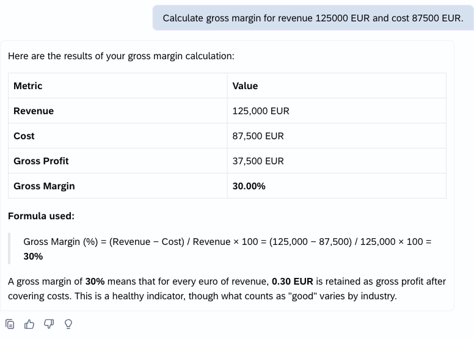
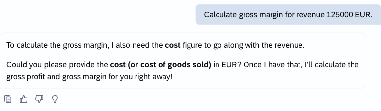

# Exercise 2: Gross Margin Calculator

## Goal

Inspect and test a supplied skill that collects required inputs, validates them, and uses a bundled script for deterministic arithmetic. Notice what belongs in the instructions, script, and reference file.

## Base prompt

`Calculate gross margin for revenue 125000 EUR and cost 87500 EUR.`

Expected result:

- Inputs: revenue 125000 EUR; cost 87500 EUR
- Gross Profit: 37500.00 EUR
- Gross Margin: 30.00%
- Warning: None

## Clarification and edge prompts

Start a **new conversation in agentic thinking mode for each prompt**, so values from the base calculation are not reused. Answer any clarification in that same conversation.

- `Calculate gross margin for revenue 125000 EUR.` Expected: ask for cost and do not invent it.
- `Calculate gross margin for revenue 0 and cost 500 EUR.` Expected: gross profit -500.00 EUR, undefined gross margin, and a zero-revenue warning.
- `Calculate gross margin for revenue -10 EUR and cost 5 EUR.` Expected: reject negative revenue.
- `Calculate gross margin for revenue 100 USD and cost 60 EUR.` Expected: do not convert currency; ask for values in one currency.

When a required input is missing, the skill asks for it instead of inventing a value:

## Participant steps

1. Open `gross-margin-calculator/SKILL.md`, then its `references/formulas.md` and `scripts/calculate_margin.py`. Find the instruction that saves the inputs as JSON and calls the script. Notice how the reference provides the fallback rules; you do not need to understand every line of Python.
2. Import the complete unzipped `gross-margin-calculator` folder in Joule Work.
3. Enable the imported skill and disable both greeters from Exercise 1.
4. Start a new conversation, select agentic thinking mode, and run the base prompt.
5. Compare the result with the expected values.
6. Run each clarification and edge prompt in its own fresh conversation and record the behavior.
7. If Python execution is unavailable, confirm that the skill uses and discloses the formula fallback.

## Optional extension: target margin

Add a target-margin input and use the reference formula to calculate required revenue at the current cost. Validate that the target is below 100 percent, keep decimal half-up rounding, and label the extension result separately from the base output. Replace the imported skill using the [shared replacement procedure](../../README.md#replacing-an-imported-skill), then test your change.

## Summary

You inspected and tested an input/output contract, traced the instruction-to-script handoff, and checked validation, rounding, and disclosed fallback behavior.

Continue to - [Exercise 3 - Sales Order Exception Prioritizer](../ex3/README.md)
