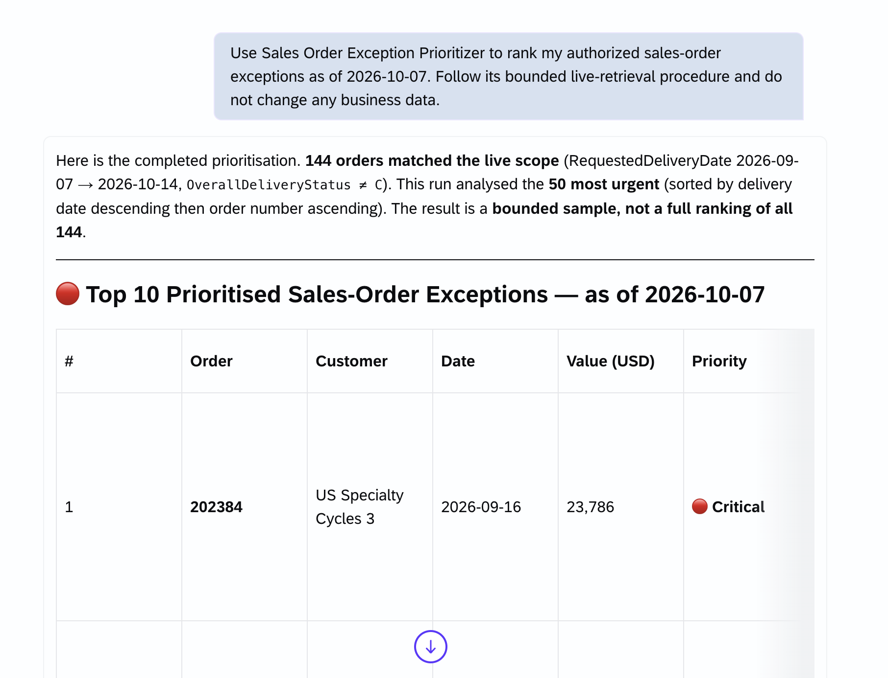
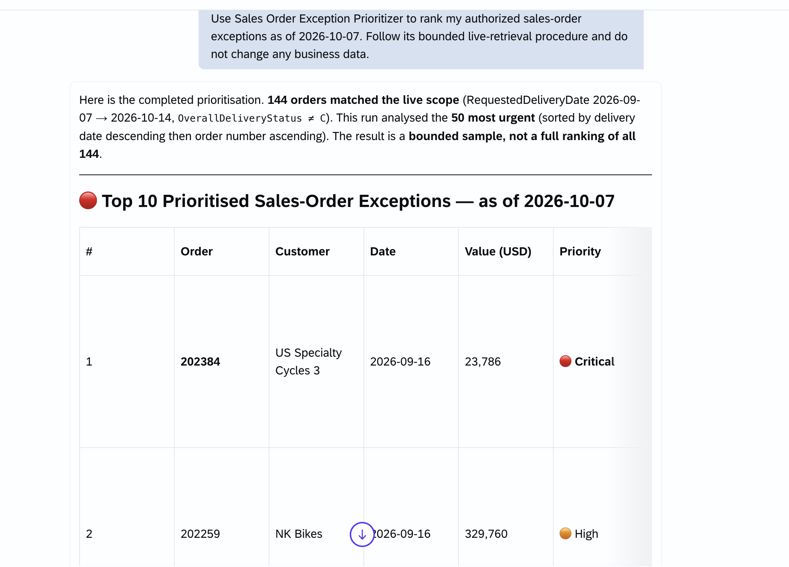
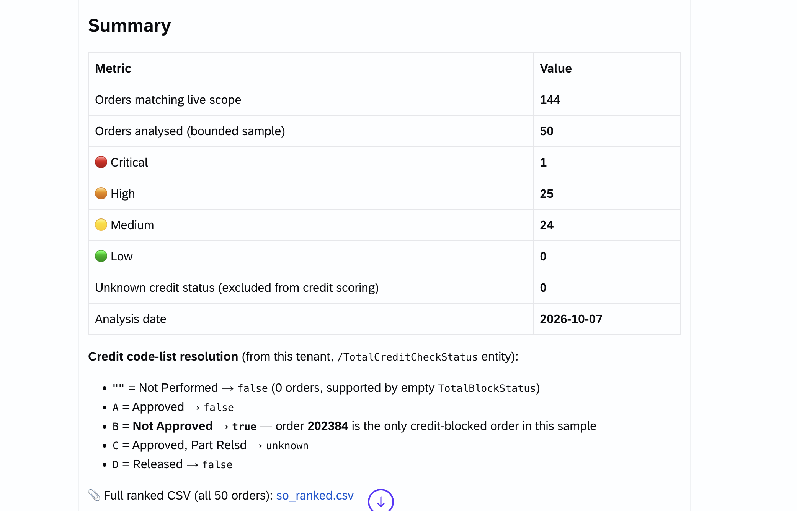
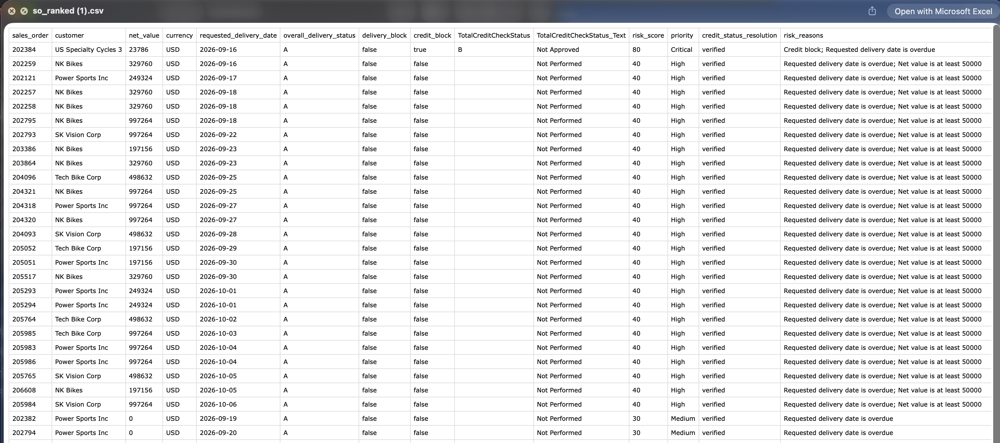
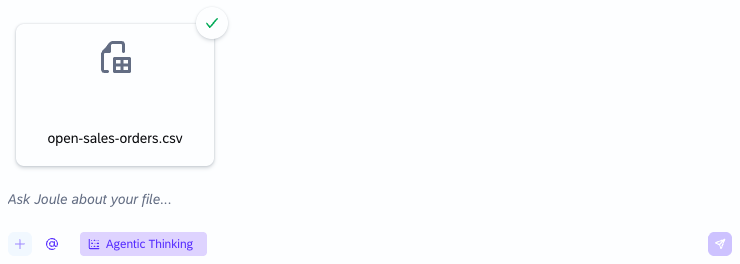
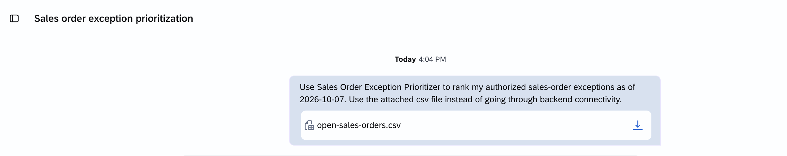
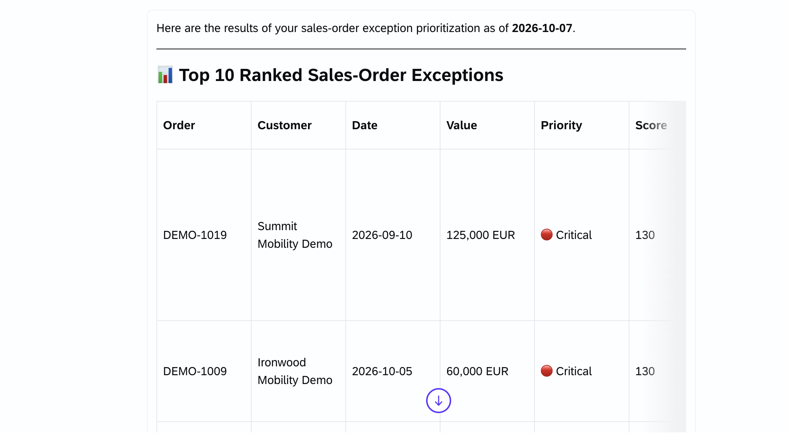
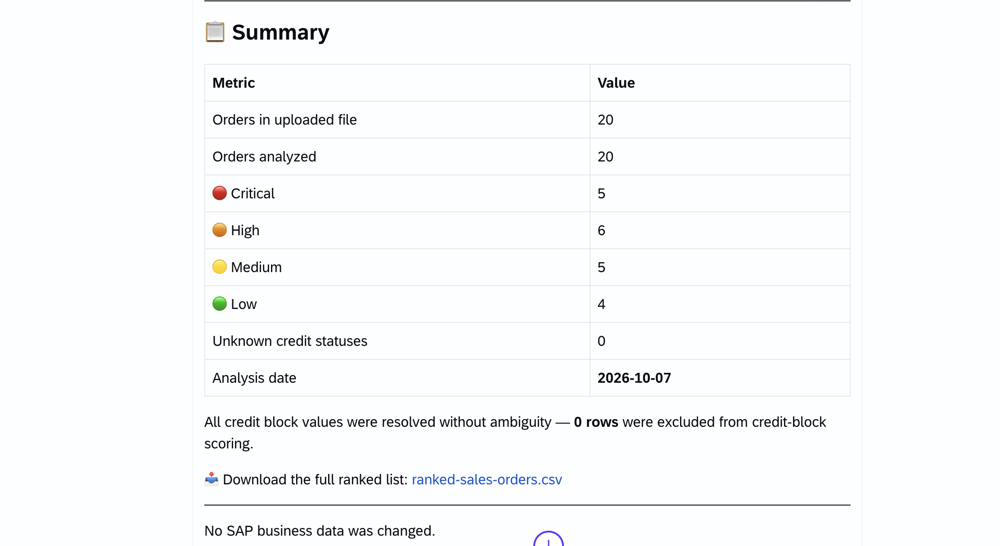

# Exercise 3: Sales Order Exception Prioritizer

## Goal

Combine authorized SAP data retrieval with deterministic, read-only local scoring. The custom skill cannot connect directly to SAP S/4HANA. An available SAP-published skill retrieves data, or the participant supplies a CSV.

## Live path

Before the workshop, confirm the exact SAP-published skill name and supported fields in the tenant.

Prompt:

`Use Sales Order Exception Prioritizer to rank my authorized sales-order exceptions as of 2026-10-07. Follow its bounded live-retrieval procedure .`

The skill first counts authorized, incomplete orders with requested delivery dates from 2026-09-07 through 2026-10-14. It then retrieves at most 50 matching orders, sorted by requested delivery date descending before the limit is applied. If more than 50 match, Joule should state that briefly and continue without asking for confirmation. It should show the 10 highest-ranked results and clearly state that the analysis is a bounded sample.

If the SAP capability cannot count, filter, sort, and limit on the server before retrieval, use the fixture fallback rather than analyzing an arbitrary first page.

For live data, `TotalCreditCheckStatus` is a tenant code-list value, not a Boolean. The skill must retrieve the code-list text for the exact value before mapping it to `credit_block`. It must not guess from a raw code such as `D`, borrow a mapping from another SAP field, or treat every nonempty value as blocked. Unresolved or conflicting values remain `unknown` and receive no credit-block points; the result reports them separately.

### Example live result

Compare your response with the captured workshop run below. Live records and counts may differ. These screenshots illustrate the live path, not the expected results for the fixture fallback.

Joule states the matching count and the bounded analysis scope before presenting the results:

The ranked table highlights the highest-priority orders:

The summary shows priority totals, unknown credit statuses, and the credit-code meanings retrieved for this tenant. Do not copy these mappings into your skill as universal SAP rules.

When a ranked CSV is available, download and open it to inspect the full analyzed sample, scores, and reasons:

## Fixture fallback path

1. Attach `sample-data/open-sales-orders.csv`.

   

2. Run: `Use Sales Order Exception Prioritizer to rank sales-order exceptions as of 2026-10-07. Use the attached csv file instead of going through backend connectivity.`

   

3. Confirm that the ranked table is sorted by score descending, requested date ascending, and sales order ascending.

   

4. Confirm these totals: Critical 5, High 6, Medium 5, Low 4, total 20.

   

5. Use the download link, when available, to open the full ranked CSV and compare it with the expected leading results below.

## Expected leading results for the fixture

- `DEMO-1019`: score 130, Critical, credit block, delivery block, overdue date, and high value.
- `DEMO-1009`: score 130, Critical, credit block, delivery block, overdue date, and high value.
- `DEMO-1003`: score 90, Critical, both credit and delivery blocks.

## Troubleshooting

| Problem | Action |
| --- | --- |
| No SAP-published S/4HANA capability | Use the fixture fallback. |
| Insufficient authorization | Do not broaden access. Use the synthetic fixture. |
| More than 50 orders match | Analyze the bounded 50-order sample and disclose the matching and analyzed counts. Do not fetch more pages. |
| Capability cannot filter or sort before limiting | Do not analyze an arbitrary first page. Use the synthetic fixture. |
| Credit status text is unavailable or conflicts with overall block status | Keep credit status `unknown`, award no credit-block points, and report the row for review. |
| Missing or renamed columns | Correct the CSV to the eight required column names. Do not guess mappings. |
| Script execution unavailable | Inspect the deterministic rules and use facilitator-provided expected fixtures. |
| Empty result | Confirm the filter and authorization. A zero-count summary is valid. |
| Validation identifies a row and field | Correct that value, then rerun the script. |

## Extensions

- Change the high-value threshold and explain which priorities change.
- Add an `owner` column and group the action list by owner.
- Retain the generated ranked CSV as a downloadable result.

All paths remain read-only. Do not add sales-order updates, release actions, or write-back instructions.

## Summary

You used supplied or authorized tabular data, applied deterministic risk rules, handled failure paths, and preserved read-only and authorization boundaries.

Continue to - [Exercise 4 - Build a Skill for a Line-of-Business Scenario](../ex4/README.md)
