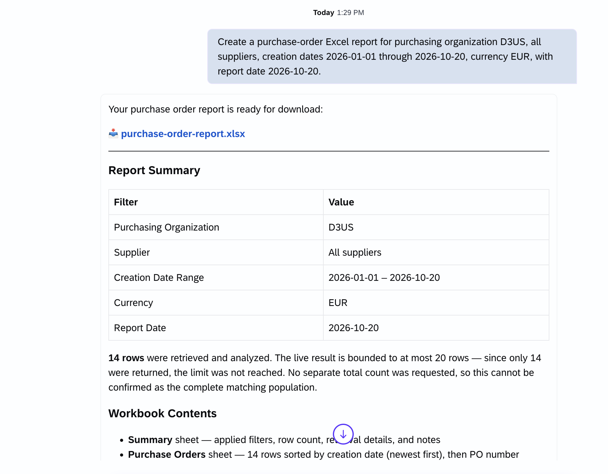
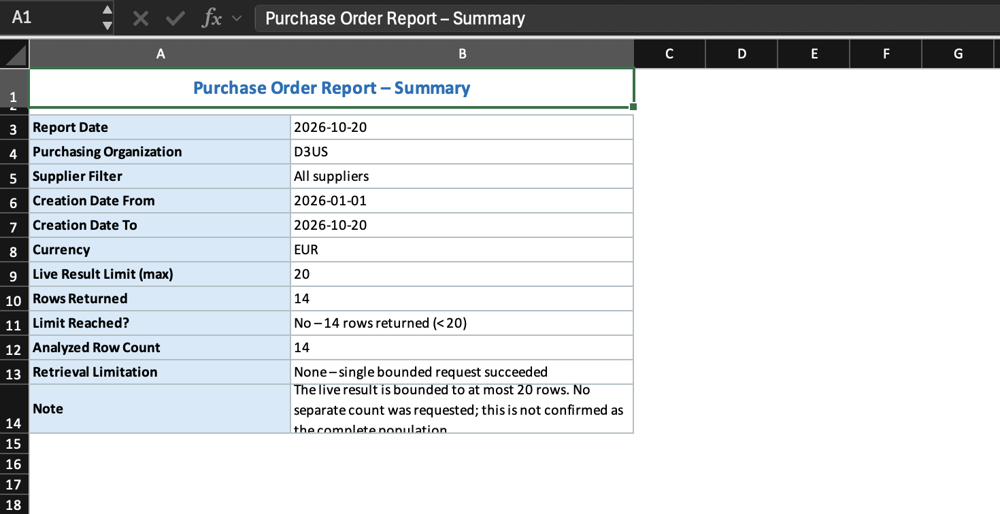
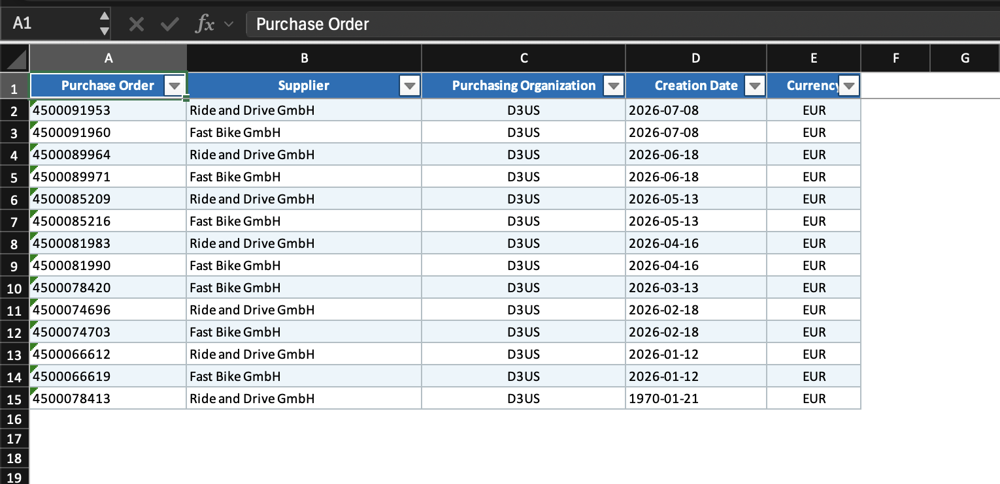
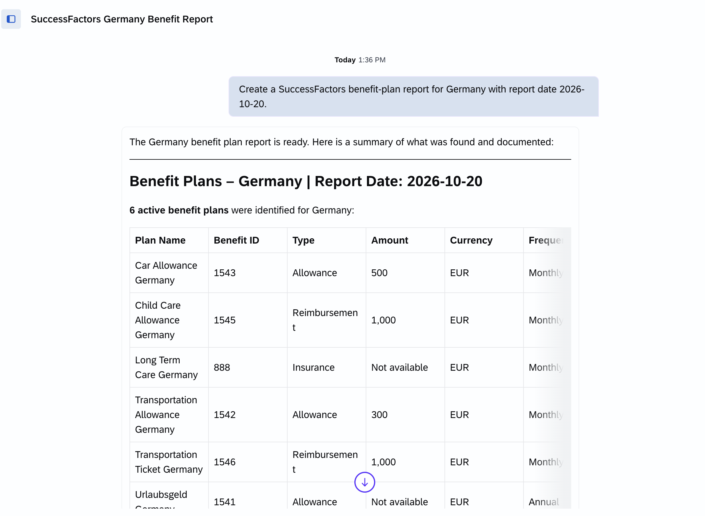
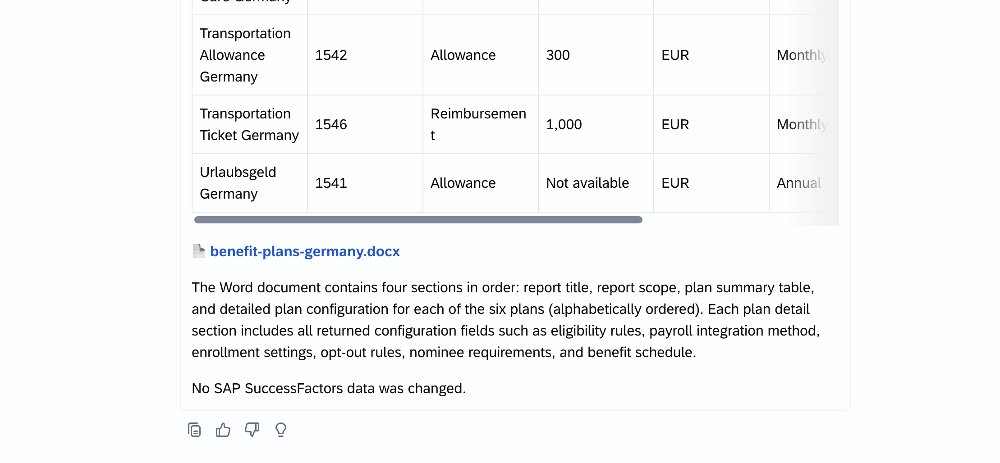
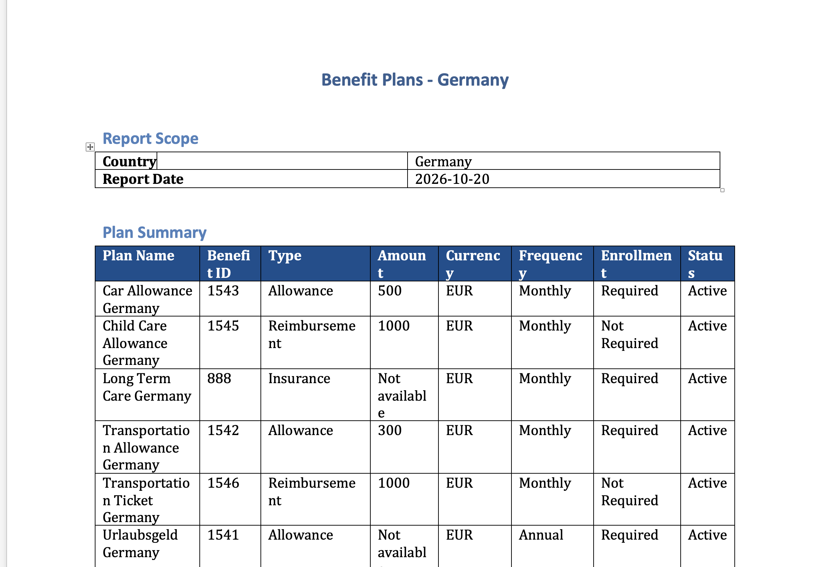
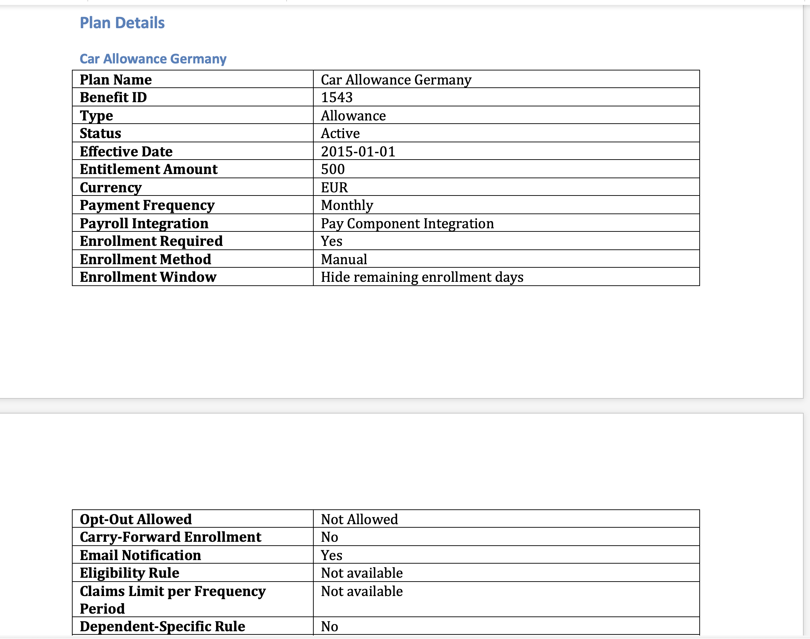

# Exercise 4: Build a Skill for a Line-of-Business Scenario

## Goal

Choose one defined SAP S/4HANA or SAP SuccessFactors outcome, create the custom skill manually or with Joule, and verify the generated business document against the expected output.

> [!NOTE]
> **Compare the result, not every pixel**
> Wording, colors, table widths, and page breaks may vary slightly from the screenshots. Clear skill instructions should still produce highly similar report content and structure. Run the sample prompt for your chosen option, compare the response and downloaded file with the screenshots, and verify every checklist item. Live records and counts can differ by workshop identity or tenant. The written output contract takes precedence over the screenshots; a different required filename, missing section, invalid date, or incorrect sort order is a defect to fix, not acceptable variation.

## Choose one scenario

Complete one of the following two currently supported scenarios. The business outcome and output format are fixed; you design the skill that achieves them.

The exact SAP-published skill names can differ by workshop tenant. Before starting, confirm in **Explore Skills** that your chosen scenario has an available capability and that your workshop identity can access the required data. A custom skill cannot connect directly to an SAP backend; an available SAP-published skill retrieves authorized data and the custom skill prepares the report.

## Why build a custom skill?

Agentic Thinking may be able to complete a similar request without your custom skill, but its retrieval strategy and output can vary between conversations. Your custom skill turns the request into a reusable business procedure: it asks for the same required inputs, applies the same safety boundaries and retrieval limit, and produces a report with a predictable filename and structure.

The SAP-published business skill supplies authorized business data, the `xlsx`, `docx`, or `pptx` skill creates the file, and your custom skill defines how those capabilities are combined. The goal is therefore not merely to generate a file once, but to make the result repeatable, governed, and easy to verify.

## Enable the required skills

Before building or running your custom skill, open **Explore Skills** and enable both the business skill and the output skill required by your option:

| Option | Business skill | Output skill |
| --- | --- | --- |
| SAP S/4HANA purchase-order report | The facilitator-confirmed `s4hana-public-cloud` skill | `xlsx` |
| SAP SuccessFactors benefit-plan country report | `successfactors-hr` | `docx` |
<!-- SAP Ariba Buying option temporarily disabled because the live composed use case could not be qualified reliably.
| SAP Ariba Buying requisition-item review | The facilitator-confirmed SAP Ariba Buying skill | `pptx` |
-->

Use the exact skill names shown in the workshop catalog. Confirm that each required toggle is on and that both skills appear under **Active Skills**. If the required business or output skill is missing, stop and ask the facilitator which option is supported; enabling only your custom skill is not sufficient.

The **Active Skills** view is the final readiness check. The cards shown in your tenant will depend on the option you choose.


## Option A: SAP S/4HANA — Filtered Purchase Order Excel Report

### Target outcome

Create a custom skill that asks for these filters:

- one specific purchasing organization;
- supplier, or `all suppliers`;
- purchase-order creation date range;
- currency;
- report date in `YYYY-MM-DD` format.

The skill uses an available SAP S/4HANA capability to retrieve matching purchase orders and creates `purchase-order-report.xlsx`.

The workbook must contain:

1. A worksheet named `Summary` with the applied filters, report date, number of analyzed purchase orders, and the 20-record live limit. The live path does not make a separate count request.
2. A worksheet named `Purchase Orders` with these columns in this order:
   - Purchase Order
   - Supplier
   - Purchasing Organization
   - Creation Date
   - Currency
3. One row per retrieved purchase order, sorted by creation date descending and then purchase-order number ascending, with at most 20 rows.
4. A clear note that the live result is bounded and may not represent all matching records.

Keep this report limited to the five specified columns and at most 20 matching purchase orders. Do not include monetary totals or retrieve additional pages.

### Sample prompt

Run this request with your custom skill enabled:

```text
Create a purchase-order Excel report for purchasing organization D3US, all suppliers, creation dates 2026-01-01 through 2026-10-20, currency EUR, with report date 2026-10-20.
```

Use these values when supported by the workshop tenant; otherwise ask the facilitator for supported values and keep your chosen prompt unchanged when retesting. Expected artifact: `purchase-order-report.xlsx`.

### Compare with the screenshots

Compare Joule's response and the downloaded workbook with these captured examples:







> [!TIP]
> **A real defect is an opportunity to improve the skill**
> The table screenshot is a **before** example: PO `4500078413` displays `1970-01-21`, outside the requested range. The [date-fix appendix](appendix-date-fix.md) shows how the tester asked Joule to explain the error, supplied the source skill, and obtained an improved package for reimport and retesting. Do not reproduce the date error or trust the chat summary alone; validate the opened workbook. The captured count of 14 is illustrative, not a required result.

### Verify the output

Open `purchase-order-report.xlsx` and confirm:

- both worksheets exist with the exact names;
- the `Summary` values match the filters used in the request;
- the `Purchase Orders` columns are in the required order;
- every visible row matches the filters;
- the rows follow the required sort order;
- no more than 20 purchase-order rows are present;
- a zero-result workbook has an empty table below the headers rather than a message row;
- values are not converted between currencies;

## Option B: SAP SuccessFactors - Benefit-Plan Country Report

### Target outcome

Create a custom skill that asks for a **country** and **report date** (`YYYY-MM-DD`), retrieves authorized benefit plans with `successfactors-hr`, and uses `docx` to create `benefit-plans-<country-slug>.docx` — for example, `benefit-plans-germany.docx`.

Keep the skill focused:

- Ask for missing inputs. Include only plans matching the requested country; if country metadata is unavailable, use an exact country-name match in the plan name.
- Retrieve once. If retrieval fails, is incomplete, or returns no matching plans, explain the result and stop without creating a document.
- Use returned plan information only. Do not include personal enrollment or compensation data, or change SuccessFactors data.

Include these four sections in order:

1. **Title:** `Benefit Plans - <Country>`.
2. **Report Scope:** country and report date.
3. **Plan Summary:** a table with `Plan Name`, `Benefit ID`, `Type`, `Amount`, `Currency`, `Frequency`, `Enrollment`, and `Status`, sorted alphabetically by plan name. Use `Not available` for missing values.
4. **Plan Details:** one subsection per plan in the same order, using available configuration details such as effective date, enrollment settings, or eligibility rules.

Keep the document limited to these sections, without extra process commentary.

### Sample prompt

Run this request with your custom skill enabled:

```text
Create a SuccessFactors benefit-plan report for Germany with report date 2026-10-20.
```

Use Germany when supported by the workshop tenant; otherwise ask the facilitator for a supported country and keep your chosen prompt unchanged when retesting. Expected artifact for Germany: `benefit-plans-germany.docx`.

### Compare with the screenshots

Compare Joule's response, download link, and the opened Word document with these captured examples:









The captured run contains six plans. Your authorized data may differ; verify the required sections, columns, ordering, and returned values rather than copying the example's plan count or amounts. Include only available fields in `Plan Details`, even where the screenshot displays an unavailable field.

### Verify the output

Open the generated Word file and confirm:

- the filename, country, and report date match your request;
- the four sections appear in order, without extra process commentary;
- the summary has the specified columns and alphabetical plan order;
- each plan has a matching detail subsection using returned information only;
- all plans match the requested country, and no personal enrollment or compensation data appears.

<!-- SAP Ariba Buying option temporarily disabled because the live composed use case could not be qualified reliably.

## Option C: SAP Ariba Buying — Requisition Item Review PowerPoint

### Target outcome

Create a custom skill that asks for these filters:

- plant code, or `all authorized plants`;
- fixed vendor code, or `all authorized vendors`;
- requisition-item delivery-date range;
- report date.

The skill uses the available SAP Ariba Buying capability to retrieve authorized purchase requisition items and creates `requisition-item-review.pptx`. The observed Buying result returns item-level data, so preserve the purchase requisition number and item number separately. Do not substitute SAP Ariba Sourcing.

Make exactly one Buying request and retrieve at most 20 items. Use only fields returned by the capability: purchase requisition and item number, description, quantity and unit, price and currency, price basis, purchasing group, plant, fixed vendor, purchasing organization, and delivery date. On an authorization, connection, timeout, partial, truncated, or unavailable-field result, do not retry or switch services; report the first error and stop.

The presentation must contain exactly five slides:

1. `Purchase Requisition Item Review` — title, applied delivery-date range, and report date.
2. `Scope and Filters` — plant, fixed vendor, delivery-date range, analyzed-item count, and the 20-item limit.
3. `Item Summary` — analyzed-item count, sums of returned item prices grouped by currency, and counts by plant and fixed vendor. Do not describe item-price sums as requisition totals.
4. `Upcoming Requisition Items` — up to five items sorted by delivery date ascending, then requisition number and item number ascending. Show requisition and item number, description, quantity and unit, price and currency, plant, fixed vendor, and delivery date.
5. `Review Points` — factual observations and items requiring human review; no approval recommendation may be presented as an automated decision.

### Verify the output

Open `requisition-item-review.pptx` and confirm:

- it contains exactly five slides with the required titles and order;
- the scope slide contains every filter from the request;
- the summary agrees with the retrieved data;
- slide 4 contains no more than five requisition items and uses the required sort order and fields;
- observations are supported by the retrieved data;
- currencies remain separate and are not converted;
- requisition numbers and item numbers, including leading zeros, are preserved separately;
- no requisition was created, changed, submitted, or approved.

-->

## Build and run your skill

1. Choose Option A or B.
2. In **Explore Skills**, enable the required business skill and `xlsx` or `docx` output skill shown in the table above. Confirm that both appear under **Active Skills**.
3. Create a lowercase, hyphenated skill folder containing `SKILL.md`.
4. Build the skill manually or ask Joule to help draft it.
5. Ensure the skill defines its purpose, required filters, retrieval handoff, validation, exact output structure, sorting, missing-data behavior, and read-only boundary.
6. Import the complete unzipped skill folder, enable it, and select agentic thinking mode.
7. Run the sample prompt for your selected option, using facilitator-confirmed values if the examples are unsupported.
8. Download and open the generated file.
9. Compare the response and file with the screenshots, then verify every checklist item for your selected option.
10. If a check fails, improve the skill, reimport it, and run the same request again.

## FYI — Tips for improving your skill

- If you detect a defect, ask Joule to explain it and suggest improvements.
- Attach your own `SKILL.md` or source package and ask Joule to update it. Download, extract, and review the result before replacing the old imported custom skill.
- Retest the same prompt in a new conversation and verify the opened file against the checklist.

See [Appendix: Improve a Skill with Joule](appendix-date-fix.md) for a short illustrated date-fix example. This is optional troubleshooting guidance, not an additional required scenario.

## Optional: compare with the facilitator reference skill

After building and testing your own skill, you can import the completed reference version for comparison:

1. Open the matching folder in [`facilitator-test-skills`](facilitator-test-skills/README.md): [`s4-purchase-order-excel-report`](facilitator-test-skills/s4-purchase-order-excel-report/) for Option A or [`successfactors-benefit-plan-country-report`](facilitator-test-skills/successfactors-benefit-plan-country-report/) for Option B.
2. Import its `SKILL.md` through **Explore Skills > Import** (or the complete unzipped folder if it contains supporting files).
3. Disable your own custom skill and enable the reference skill. Keep the required business and output skills enabled and confirm all three under **Active Skills**.
4. Start a new conversation, select agentic thinking mode, and run exactly the same prompt and filter values used to test your own skill.
5. Download the reference output and compare both reports against the screenshots and verification checklist. Identify any instruction you need to improve in your own skill; the reference output is not a substitute for validating returned data.
6. Disable the reference skill before re-enabling and retesting your own skill in a new conversation.

Do not enable both custom versions at once: overlapping descriptions can make it unclear which skill ran. If skill provenance is not visible, record `Not visible` and compare only observable behavior. Neither version may retry a failed backend request or bypass authorization.


## Expected result

You created one custom skill that meets a predefined line-of-business outcome and generated a report in a harmonized way.


Continue to - [Exercise 5 - Freestyle](../ex5/README.md)
