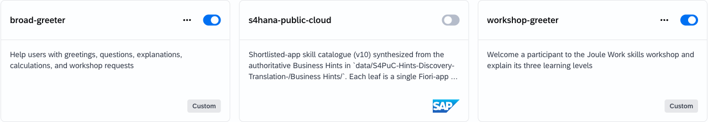

# Exercise 4: Build a Skill for a Line-of-Business Scenario

## Goal

Choose one defined SAP S/4HANA or SAP SuccessFactors outcome, create the custom skill manually or with Joule, and verify the generated business document against the expected output.

## Choose one scenario

Complete one of the following two currently supported scenarios. The business outcome and output format are fixed; you design the skill that achieves them.

The exact SAP-published skill names can differ by workshop tenant. Before starting, confirm in **Explore Skills** that your chosen scenario has an available capability and that your workshop identity can access the required data. A custom skill cannot connect directly to an SAP backend; an available SAP-published skill retrieves authorized data and the custom skill prepares the report.

## Why build a custom skill?

Agentic Thinking may be able to complete a similar request without your custom skill, but its retrieval strategy and output can vary between conversations. Your custom skill turns the request into a reusable business procedure: it asks for the same required inputs, applies the same safety boundaries and retrieval limit, and produces a report with a predictable filename and structure.

The SAP-published business skill supplies authorized business data, the `xlsx`, `docx`, or `pptx` skill creates the file, and your custom skill defines how those capabilities are combined. The goal is therefore not merely to generate a file once, but to make the result repeatable, governed, and easy to verify.

## Enable the required skills

Before building or running your custom skill, open **Explore Skills** and enable both the business skill and the output skill required by your option:

| Option | Business skill | Output skill |
| --- | --- | --- |
| SAP S/4HANA purchase-order report | The facilitator-confirmed `s4hana-public-cloud` skill | `xlsx` |
| SAP SuccessFactors benefit-plan country report | `successfactors-hr` | `docx` |
<!-- SAP Ariba Buying option temporarily disabled because the live composed use case could not be qualified reliably.
| SAP Ariba Buying requisition-item review | The facilitator-confirmed SAP Ariba Buying skill | `pptx` |
-->

Use the exact skill names shown in the workshop catalog. Confirm that each required toggle is on and that both skills appear under **Active Skills**. If the required business or output skill is missing, stop and ask the facilitator which option is supported; enabling only your custom skill is not sufficient.

The **Active Skills** view is the final readiness check. The cards shown in your tenant will depend on the option you choose.

## Option A: SAP S/4HANA — Filtered Purchase Order Excel Report

### Target outcome

Create a custom skill that asks for these filters:

- one specific purchasing organization;
- supplier, or `all suppliers`;
- purchase-order creation date range;
- currency.

The skill uses an available SAP S/4HANA capability to retrieve matching purchase orders and creates `purchase-order-report.xlsx`.

The workbook must contain:

1. A worksheet named `Summary` with the applied filters, report date, number of analyzed purchase orders, and the 20-record live limit. The live path does not make a separate count request.
2. A worksheet named `Purchase Orders` with these columns in this order:
   - Purchase Order
   - Supplier
   - Purchasing Organization
   - Creation Date
   - Currency
3. One row per retrieved purchase order, sorted by creation date descending and then purchase-order number ascending, with at most 20 rows.
4. A clear note that the live result is bounded and may not represent all matching records.

The qualified workshop service did not return a meaningful header-level net-value field. The live skill therefore must not request, filter, sort, or total by net value. It must make one narrowly filtered detail request and must not make a separate count request, fetch additional pages, probe alternative services, or retry after a failed detail request. On the first retrieval failure, it stops and asks for a facilitator-approved CSV fallback.

### Verify the output

Open `purchase-order-report.xlsx` and confirm:

- both worksheets exist with the exact names;
- the `Summary` values match the filters used in the request;
- the `Purchase Orders` columns are in the required order;
- every visible row matches the filters;
- the rows follow the required sort order;
- no more than 20 purchase-order rows are present;
- a zero-result workbook has an empty table below the headers rather than a message row;
- values are not converted between currencies;
- no purchase order was created, changed, approved, or released.

## Option B: SAP SuccessFactors - Benefit-Plan Country Report

### Target outcome

Create a custom skill that asks for a country and report date, retrieves the signed-in participant's authorized benefit-plan data with `successfactors-hr`, and creates `benefit-plans-<country-slug>.docx` with the `docx` skill. For example, the country `Germany` produces `benefit-plans-germany.docx`.

Validate that country is a non-empty country name and that report date uses `YYYY-MM-DD`. Make exactly one call to `successfactors-hr`. Retrieve only benefit plans whose configured country or region matches the requested country. If that metadata is unavailable, an exact country-name match in the returned plan name is an acceptable fallback; state this matching method in `Data Notes`. Do not use partial-name, alias, or inferred regional matches. Retrieve the returned plan name, benefit ID, type, active status, effective date, entitlement amount and currency, payment frequency, payroll integration, enrollment method and requirement, eligibility rule, and any returned opt-out, carry-forward, notification, claims-limit, dependent, or nominee information. Do not retrieve personal enrollments, employee compensation, another employee's data, or benefit plans outside the requested country.

On any error, including authorization, connection, timeout, partial result, or truncated result, do not retry, switch services, or probe alternatives. Report the first error and stop. If the response contains no matching plans, create no document; state that no matching benefit plans were returned.

The document must contain these sections in this order:

1. `Benefit Plans - <Country>`
2. `Report Scope` - requested country and report date.
3. `Plan Summary` - a table with `Plan Name`, `Benefit ID`, `Type`, `Amount`, `Currency`, `Frequency`, `Enrollment`, and `Status`, sorted alphabetically by `Plan Name`. Use `Not available` only when a field was not returned.
4. `Plan Details` - one subsection per plan, in the same alphabetical order as the summary. Each subsection must preserve returned values and include only available fields from: plan name, benefit ID, type, status, effective date, entitlement amount and currency, frequency, payroll integration, enrollment requirement and method, enrollment window, opt-out, carry-forward enrollment, notification, eligibility rule, claims limit, dependent-specific rules, nominee requirement, and benefit schedule.

The document contains only the report title, scope, summary, and plan-detail content. Do not add `Data Notes`, source descriptions, matching-method explanations, read-only statements, eligibility or enrollment disclaimers, payment-entitlement statements, legal or tax disclaimers, or any other process or skill-execution information.

### Verify the output

Open `benefit-plans-<country-slug>.docx` and confirm:

- all four sections exist in the required order;
- the report scope shows the requested country and report date;
- every summary row matches the selected country through returned country/region metadata or the disclosed exact plan-name fallback;
- the summary uses the required columns and alphabetical plan-name order;
- every plan has one detail subsection in the same order as the summary;
- details preserve the returned values and do not invent unavailable fields;
- the document has no `Data Notes`, source or matching-method explanation, read-only statement, eligibility/enrollment/payment disclaimer, or legal/tax disclaimer;
- no personal enrollment, compensation, unsupported employee information, or plans outside the requested country appear;
- no SuccessFactors data was created or changed.

<!-- SAP Ariba Buying option temporarily disabled because the live composed use case could not be qualified reliably.

## Option C: SAP Ariba Buying — Requisition Item Review PowerPoint

### Target outcome

Create a custom skill that asks for these filters:

- plant code, or `all authorized plants`;
- fixed vendor code, or `all authorized vendors`;
- requisition-item delivery-date range;
- report date.

The skill uses the available SAP Ariba Buying capability to retrieve authorized purchase requisition items and creates `requisition-item-review.pptx`. The observed Buying result returns item-level data, so preserve the purchase requisition number and item number separately. Do not substitute SAP Ariba Sourcing.

Make exactly one Buying request and retrieve at most 20 items. Use only fields returned by the capability: purchase requisition and item number, description, quantity and unit, price and currency, price basis, purchasing group, plant, fixed vendor, purchasing organization, and delivery date. On an authorization, connection, timeout, partial, truncated, or unavailable-field result, do not retry or switch services; report the first error and stop.

The presentation must contain exactly five slides:

1. `Purchase Requisition Item Review` — title, applied delivery-date range, and report date.
2. `Scope and Filters` — plant, fixed vendor, delivery-date range, analyzed-item count, and the 20-item limit.
3. `Item Summary` — analyzed-item count, sums of returned item prices grouped by currency, and counts by plant and fixed vendor. Do not describe item-price sums as requisition totals.
4. `Upcoming Requisition Items` — up to five items sorted by delivery date ascending, then requisition number and item number ascending. Show requisition and item number, description, quantity and unit, price and currency, plant, fixed vendor, and delivery date.
5. `Review Points` — factual observations and items requiring human review; no approval recommendation may be presented as an automated decision.

### Verify the output

Open `requisition-item-review.pptx` and confirm:

- it contains exactly five slides with the required titles and order;
- the scope slide contains every filter from the request;
- the summary agrees with the retrieved data;
- slide 4 contains no more than five requisition items and uses the required sort order and fields;
- observations are supported by the retrieved data;
- currencies remain separate and are not converted;
- requisition numbers and item numbers, including leading zeros, are preserved separately;
- no requisition was created, changed, submitted, or approved.

-->

## Build and run your skill

1. Choose Option A or B.
2. In **Explore Skills**, enable the required business skill and `xlsx` or `docx` output skill shown in the table above. Confirm that both appear under **Active Skills**.
3. Create a lowercase, hyphenated skill folder containing `SKILL.md`.
4. Build the skill manually or ask Joule to help draft it.
5. Ensure the skill defines its purpose, required filters, retrieval handoff, validation, exact output structure, sorting, missing-data behavior, and read-only boundary.
6. Import the complete unzipped skill folder, enable it, and select agentic thinking mode.
7. Run the skill with filter values supported by the workshop data.
8. Download and open the generated file.
9. Verify it against the checklist for your selected option.
10. If a check fails, improve the skill, reimport it, and run the same request again.

## Troubleshooting

| Problem | Action |
| --- | --- |
| The required SAP-published capability is unavailable | Choose another option or ask the facilitator which scenario is supported by the tenant. |
<!-- SAP Ariba troubleshooting is temporarily disabled with Option C.
| SAP Ariba Sourcing is unavailable but SAP Ariba Buying works | Use Option C's Buying requisition-item outcome; do not substitute or probe Sourcing. |
-->
| The `xlsx`, `docx`, or `pptx` skill is disabled | Enable the output skill for your option under **Explore Skills**, then confirm it appears under **Active Skills**. |
| A required field cannot be retrieved | Do not invent it. Ask the facilitator whether another option is supported. |
| Retrieved data cannot be handed to the custom skill | State the limitation and use facilitator-approved synthetic data if available. |
| The S/4HANA detail request fails | Stop after the first failure. Do not retry or probe other services; use a facilitator-approved CSV fallback if available. |
| The generated file cannot be opened | Check the requested format, filename, and generation instructions, then regenerate it. |
| The environment cannot generate the required file type | Preserve the same content and structure in a facilitator-approved fallback; do not claim that the target file was created. |
| The request would change business data | Stop and revise the skill so it remains read-only. |

## Expected result

You created one custom skill that meets a predefined line-of-business outcome and generated a report that passes every applicable verification check.

## Summary

You translated a defined SAP business outcome into a custom skill, combined it with authorized data retrieval, generated a business file, and verified the result against a fixed contract.

Continue to - [Exercise 5 - Freestyle](../ex5/README.md)
