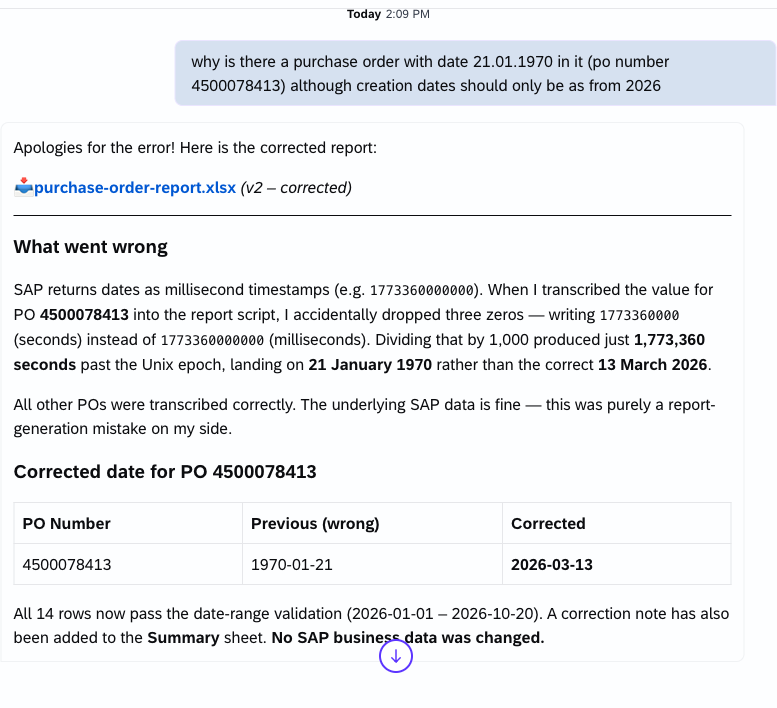
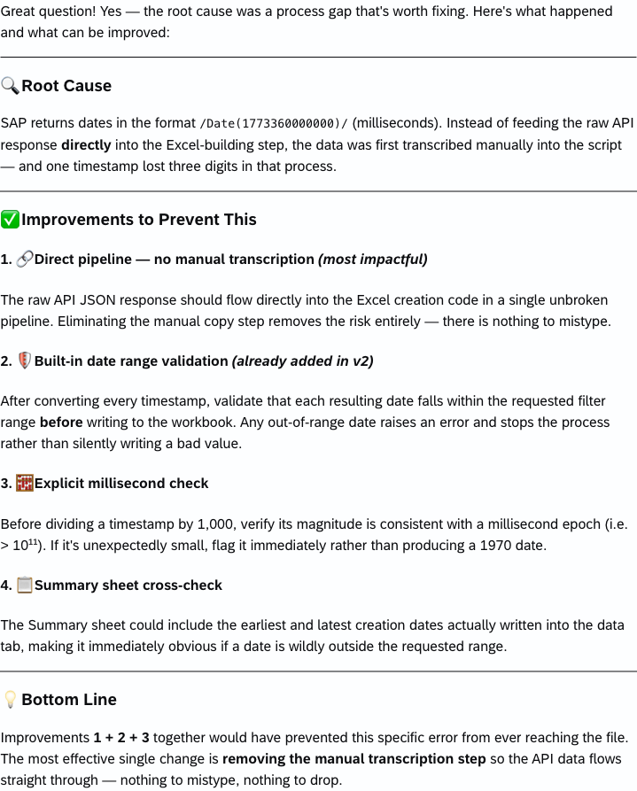
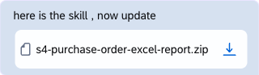
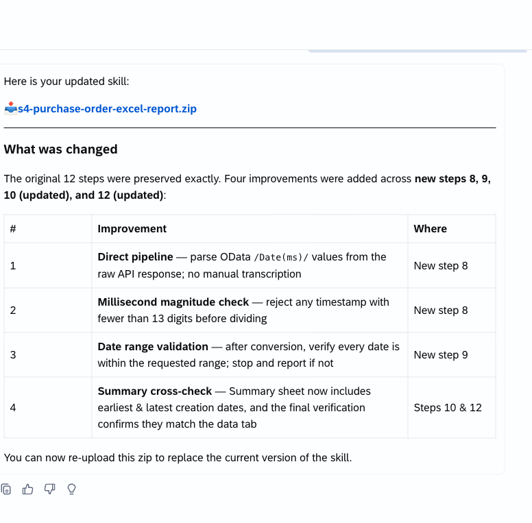
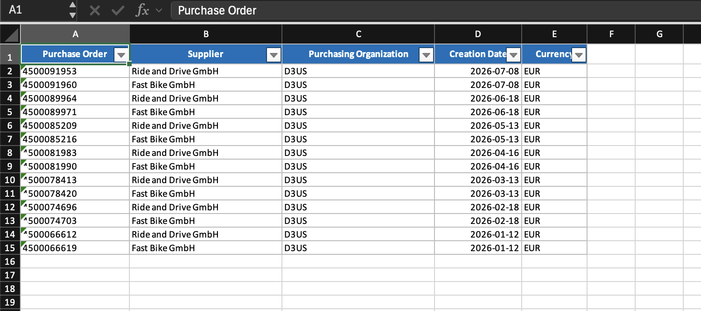

# Exercise 4 Appendix: Improve a Skill with Joule

If you find a defect, ask Joule to explain it and suggest how to improve your skill. This optional example follows an incorrect purchase-order date through diagnosis, a skill update, and the opened workbook showing the corrected date.

## 1. Identify the defect

The Excel report showed `1970-01-21` for PO `4500078413`, outside the requested date range. Joule attributed it to a timestamp-conversion mistake and proposed `2026-03-13` as the corrected date. Check the output rather than relying on the diagnosis alone.

## 2. Ask for an improvement

Joule suggested preserving the returned data, checking timestamp units, validating dates against the requested range, and cross-checking the summary against the data sheet.

## 3. Update your source skill

Attach your own `SKILL.md` or source package and ask Joule to incorporate the improvements. In this example, the source was attached as a ZIP.

Joule returned an updated skill package for download.

## 4. Reimport and verify

Download and extract the package and review the changes. Disable and remove the old imported custom skill, then follow [Importing a skill](../../README.md#importing-a-skill) to import and enable the replacement. Confirm the replacement, `SAP S/4HANA Cloud Public Edition`, and `Excel` under **Active Skills** for a live retest. For a synthetic retest, only the replacement and `Excel` are required; attach the same CSV and make no backend call.

Start a new **Agentic Thinking** conversation, run the unchanged sample prompt, open the new workbook, and validate dates against the source and filters, sorting, and the rest of the [Option A checklist](README.md#option-a-checklist). Do not describe the defect as fixed until this output has been checked.

The updated workbook capture shows PO `4500078413` with Creation Date **`2026-03-13`**, replacing the incorrect `1970-01-21`. The visible table has the five required columns and follows the required sort order. Check the `Summary` sheet separately; it is not shown in this capture.

[Return to Exercise 4](README.md) · [Optional Exercise 5](../ex5/README.md)
